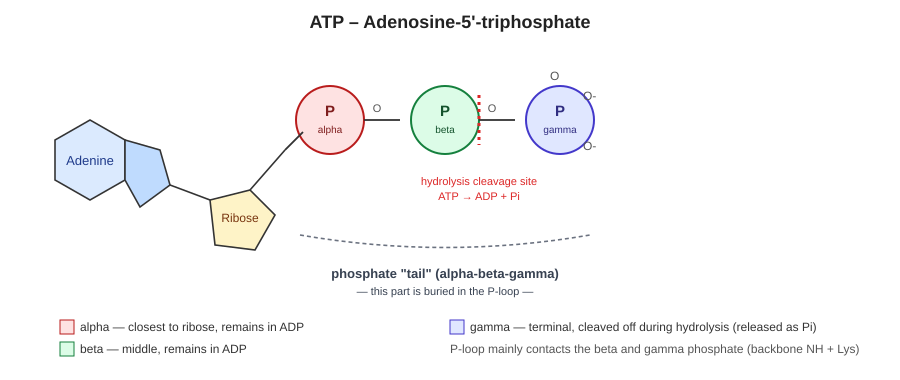
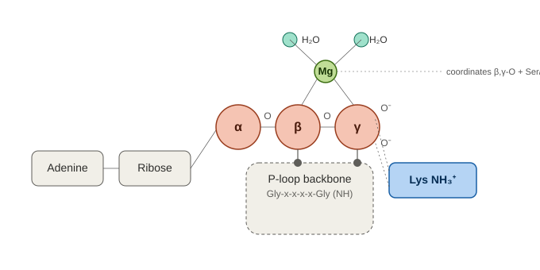

# P-loop and ATP Binding – Mechanistic Summary

## Introduction

The P-loop (phosphate-binding loop, Walker A motif) is one of the most widespread and evolutionarily oldest structural motifs binding nucleotides (ATP/GTP). The consensus sequence **G-x-x-x-x-G-K-[S/T]** forms a βαβ-type loop that wraps around the phosphate group of the nucleotide. The motif occurs across ATPases, GTPases, kinases, ABC transporters, helicases, and translation factors. The strict sequence consensus spans 8 residues, while the structurally defined loop (including the adjacent β-strand) is typically somewhat longer (~10–15 residues).

## ATP diagram – alpha, beta, gamma phosphates and the "tail"

ATP forms a linear chain: adenine–ribose–**alpha**–**beta**–**gamma** phosphate. The **alpha** phosphate is bonded directly to the ribose, while **gamma** is the terminal one (farthest from the sugar). The beta and gamma phosphates together form the so-called **"tail"** of ATP, which is the part buried in the P-loop – this segment is in direct contact with the backbone NH groups and the conserved lysine. During hydrolysis, the bond between the beta and gamma phosphate is cleaved: the gamma phosphate leaves as free Pi, while the remainder (adenine–ribose–alpha–beta) forms ADP.

## Diagram of the ATP–P-loop binding mechanism

The β and γ phosphates are buried in the P-loop backbone (contacted via backbone NH groups), lysine makes a bidentate contact with the γ-phosphate, and Mg²⁺ coordinates the β,γ-oxygens together with the Ser/Thr-OH and two water molecules.

## Key P-loop residues and their roles

| Residue(s) | Role | Type of interaction with ATP |
|---|---|---|
| Glycines (2×) | Purely conformational – no side chain to obstruct the sharp bend of the loop | Backbone NH → H-bonds to the β,γ-phosphate |
| Conserved **Lysine** | The only residue in the motif making direct, specific side-chain contact | ε-NH₃⁺ forms a bidentate bond/salt bridge to the β,γ-phosphate (~2.7–3.0 Å) |
| **Ser/Thr** | Coordinates Mg²⁺ (not the phosphate directly) | OH group → coordination bond to Mg²⁺ |

Contact with the phosphates is thus provided primarily by the loop's **backbone**, not by glycine side chains (which have none) – their role is to allow the required bend geometry. The only side chain making direct chemical contact is lysine.

## The phosphate "tail" of ATP – why γ gets the most contacts

- α-phosphate (near the ribose): 1 free oxygen, fewest contacts with the P-loop (fixed mainly by the bond to the sugar)
- β-phosphate: 1 free oxygen
- γ-phosphate (terminal): 2 free oxygens → most hydrogen bonds

The γ-phosphate is also not contacted by the P-loop alone, but by other structural elements as well (Switch I/II in GTPases, the catalytic Glu, Mg²⁺) – it is the functionally most "watched" part of the molecule, since this is precisely where catalysis and the "reading" of the ATP vs. ADP state take place.

## The role of Mg²⁺

Mg²⁺ is an essential cofactor, octahedrally coordinated (6 bonds): oxygens of the β,γ-phosphate, the OH of the P-loop Ser/Thr, and 2–3 water molecules. Functions:
1. **Charge neutralization** – at physiological pH, ATP carries a charge of ATP⁴⁻ (α: −1, β: −1, γ: −2); Mg²⁺ shields this charge density.
2. **Bridging the β,γ-phosphate** – stabilizes the geometry of the complex.
3. **Polarization of the P–O bond** – "pulls" electron density from the oxygen toward itself, increasing the electrophilicity of the phosphorus (making it more susceptible to nucleophilic attack).
4. **Catalysis** – the water coordinated in its sphere is often the molecule that performs the hydrolysis.

**Typical bond distances:**
| Bond type | Distance |
|---|---|
| Hydrogen bond (backbone NH and Lys to the β,γ-phosphate) | ~2.7–3.0 Å |
| Mg²⁺ coordination bond (to O, Ser/Thr-OH, water) | ~2.0–2.2 Å |

Coordination (dative) bond: oxygen (donor of a lone electron pair) → Mg²⁺ (acceptor, empty orbital). Stronger and geometrically stricter than a hydrogen bond.

## Walker B motif – complement to the P-loop

Located ~90–120 residues further along the sequence, but structurally close to the P-loop. Consensus hhhhD[E] (h = hydrophobic):
- **Asp** – coordinates Mg²⁺ (directly or via water)
- **Glu** – activates (deprotonates) the catalytic water, turning it into a strong nucleophile (OH⁻)

## Hydrolysis mechanism (nucleophilic substitution at P)

1. Glu (Walker B) deprotonates water → generates a nucleophile (OH⁻)
2. In-line nucleophilic attack of OH⁻ on the phosphorus of the γ-phosphate (from the side opposite the bond to the β-phosphate)
3. Transition state: pentacoordinate phosphorus (trigonal bipyramid), stabilized by Mg²⁺ and the P-loop Lys/backbone
4. Cleavage of the β–γ bond → yields ADP + **Pi** (inorganic phosphate: a free HPO₄²⁻/H₂PO₄⁻ ion, not bonded to any carbon skeleton)

The enzyme does not enable hydrolysis "out of nothing" – it accelerates it (by 10⁶–10¹²×) by stabilizing the unstable transition state.

## Where the released energy comes from

Energy is not released "from the bond" (breaking a bond is always endothermic) – it comes from the overall balance of the reaction. The products (ADP + Pi) are more stable than ATP + H₂O due to:
- release of electrostatic repulsion between the phosphates
- better resonance stabilization of free Pi
- better solvation of two smaller ions
- higher entropy (more particles)

ΔG°' ≈ −30.5 kJ/mol. Proteins "couple" this free energy to a conformational change, rather than simply dissipating it as heat.

## ATP–P-loop binding energy

Experimentally measured affinity (Kd) varies by many orders of magnitude across P-loop proteins: kinases typically **10–100 µM**, adenylate kinase on the order of tens of µM, whereas small GTPases (Ras and relatives) show **pM–nM** affinities (biologically necessary for slow spontaneous nucleotide exchange, controlled by GEF proteins). Conversion to free energy: ΔG = RT ln(Kd) → for a Kd of 1 µM, ΔG ≈ −34 kJ/mol; for tight binders (Ras), it can exceed −60 kJ/mol.

**Why an AutoDock Vina estimate is problematic for this system:**
1. **Mg²⁺ coordination** – Vina has no explicit term for coordination bonds with metals; without properly capturing Mg²⁺ (a key stabilizer of the complex), the score will underestimate reality.
2. **Highly charged ligand** – ATP⁴⁻ requires accurate electrostatics/solvation; Vina's simplified empirical charges lead to errors of several kcal/mol or more for such charged systems.
3. **No explicit water** – the catalytic water and structural waters in the Mg²⁺ coordination sphere affect binding geometry, and Vina does not include these by default.
4. **Vina score is not an absolute ΔG** – it is intended mainly for relative comparison (ranking) of ligands/poses, not for quantitative prediction of binding energy.

More accurate alternatives: MM-GBSA/MM-PBSA (post-processing of MD), FEP/TI (most accurate, computationally demanding), QM/MM (necessary to capture P–O bond polarization and charge transfer around Mg²⁺).

## Relationship to ancestral (prebiotic) amino acids

Consensus "early" (prebiotically available) alphabet of 10 amino acids: **Gly, Ala, Ser, Asp, Glu, Val, Leu, Ile, Pro, Thr** (G, A, S, D, E, V, L, I, P, T). The remaining 10 "late" amino acids (products of later biosynthetic pathways): Phe, Tyr, Arg, His, Trp, Asn, Gln, **Lys**, Cys, Met.

Among the key, conserved positions of the P-loop and Walker B motif, the following belong to the **early** set:
- both **glycines** and **Ser/Thr** from the P-loop
- both **Asp and Glu** from Walker B (Mg²⁺ coordination, activation of the catalytic water)

The only late residue among the defining positions of both motifs is **lysine** – the sole P-loop side chain that makes direct, specific (rather than merely backbone-mediated) contact with the phosphates.

This suggests a possible evolutionary scenario: the earliest P-loop precursors likely functioned without lysine, with phosphate binding provided solely by backbone NH groups and Mg²⁺/early acidic residues (Asp/Glu). The later incorporation of lysine into the genetic code may have "upgraded" the motif with a stronger, more specific grip on the γ-phosphate, potentially increasing both affinity and catalytic efficiency.

## Conformational switch – functional consequence of binding/hydrolysis

The presence/absence of the γ-phosphate acts as a molecular switch:
- **ATP/GTP bound** → "ON" conformation (switch regions fixed by H-bonds to the γ-phosphate)
- **After hydrolysis (ADP/GDP)** → loss of contacts to the γ-phosphate → switch regions relax → "OFF" conformation

Functional consequences by protein type:
- **Motor proteins** (myosin, kinesin): the bind–hydrolyze–release cycle drives a repeated mechanical step (the "power stroke")
- **Small GTPases** (Ras and others): hydrolysis acts as a signaling switch-off; without it, the protein would remain permanently active (cf. oncogenic Ras mutations)
- **ABC transporters**: ATP binding → dimerization of the P-loop domains (transport); hydrolysis → dissociation, cycle reset
- **Kinases**: instead of hydrolysis by water, the γ-phosphate is transferred directly to a substrate (phosphorylation)

Without hydrolysis/phosphate transfer, the process would amount to a one-off, irreversible conformational change – the cycle could not close, and the process (movement, signaling, transport) could not repeat.
