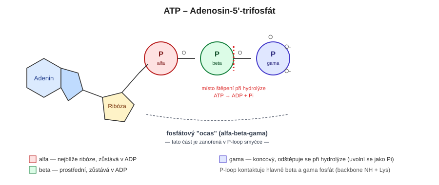
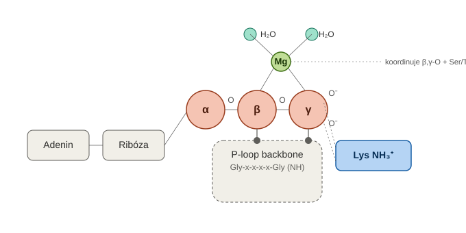

# P-loop a vazba ATP – mechanistické shrnutí

## Úvod

P-loop (phosphate-binding loop, Walker A motiv) je jeden z nejrozšířenějších a evolučně nejstarších strukturních motivů vázajících nukleotidy (ATP/GTP). Konsenzuální sekvence **G-x-x-x-x-G-K-[S/T]** tvoří smyčku typu βαβ, která obemyká fosfátovou skupinu nukleotidu. Motiv se vyskytuje napříč ATPázami, GTPázami, kinázami, ABC transportéry, helikázami i translačními faktory. Přísný sekvenční konsenzus má 8 reziduí, strukturně definovaná smyčka (včetně přilehlého β-řetězce) bývá o něco delší (~10–15 reziduí).

## Schéma ATP – alfa, beta, gama fosfát a "ocas"

ATP tvoří lineární řetězec: adenin–ribóza–**alfa**–**beta**–**gama** fosfát. **Alfa** fosfát je navázán přímo na ribózu, **gama** je koncový (nejvzdálenější od cukru). Fosfátové skupiny beta a gama společně tvoří tzv. **"ocas"** ATP, kterým je molekula zanořena do P-loop smyčky – právě tato část je v přímém kontaktu s backbone NH skupinami a konzervovaným lysinem. Při hydrolýze se štěpí vazba mezi beta a gama fosfátem: gama fosfát odchází jako volný Pi, zbytek (adenin–ribóza–alfa–beta) tvoří ADP.

## Schéma mechanismu vazby ATP do P-loop

β a γ fosfát jsou zanořené v P-loop backbone smyčce (kontakt přes NH skupiny páteře), lysin dělá bidentátní kontakt na γ-fosfát a Mg²⁺ koordinuje β,γ-kyslíky spolu s Ser/Thr-OH a dvěma molekulami vody.

## Klíčová rezidua P-loop a jejich role

| Rezidua | Role | Typ interakce s ATP |
|---|---|---|
| Glyciny (2×) | Čistě konformační – žádný postranní řetězec nebrání ostrému ohybu smyčky | Backbone NH → H-vazby na β,γ-fosfát |
| Konzervovaný **Lysin** | Jediné reziduum motivu s přímým specifickým kontaktem přes postranní řetězec | ε-NH₃⁺ tvoří bidentátní vazbu/solný můstek na β,γ-fosfát (~2.7–3.0 Å) |
| **Ser/Thr** | Koordinuje Mg²⁺ (ne fosfát přímo) | OH skupina → koordinační vazba na Mg²⁺ |

Kontakt s fosfáty tedy zajišťuje primárně **páteř (backbone)** smyčky, ne postranní řetězce glycinů (ty žádné nemají) – jejich funkce je umožnit potřebnou geometrii ohybu. Jediný postranní řetězec s přímým chemickým kontaktem je lysin.

## Fosfátový "ocas" ATP – proč γ dostává nejvíc kontaktů

- α-fosfát (u ribózy): 1 volný kyslík, nejméně kontaktů s P-loop (fixován spíš vazbou na cukr)
- β-fosfát: 1 volný kyslík
- γ-fosfát (koncový): 2 volné kyslíky → nejvíc vodíkových vazeb

γ-fosfát navíc není kontaktován jen P-loopem, ale i dalšími strukturními elementy (Switch I/II u GTPáz, katalytický Glu, Mg²⁺) – je to funkčně nejsledovanější část molekuly, protože právě tam se odehrává katalýza a "čtení" stavu ATP vs. ADP.

## Role Mg²⁺

Mg²⁺ je nezbytný kofaktor, koordinovaný oktaedricky (6 vazeb): kyslíky β,γ-fosfátu, OH z Ser/Thr P-loop, 2–3 molekuly vody. Funkce:
1. **Neutralizace náboje** – ATP má při fyziologickém pH náboj ATP⁴⁻ (α: −1, β: −1, γ: −2); Mg²⁺ stíní hustotu tohoto náboje.
2. **Přemostění β,γ-fosfátu** – zpevňuje geometrii komplexu.
3. **Polarizace P–O vazby** – "vysává" elektronovou hustotu z kyslíku k sobě, čímž zvyšuje elektrofilitu fosforu (činí ho náchylnějším k nukleofilnímu ataku).
4. **Katalýza** – koordinovaná voda v jeho sféře bývá tou molekulou, která provede hydrolýzu.

**Typické vzdálenosti vazeb:**
| Typ vazby | Vzdálenost |
|---|---|
| Vodíková vazba (backbone NH i Lys s β,γ-fosfátem) | ~2.7–3.0 Å |
| Koordinační vazba Mg²⁺ (s O, Ser/Thr-OH, vodou) | ~2.0–2.2 Å |

Koordinační (dativní) vazba: kyslík (donor volného elektronového páru) → Mg²⁺ (akceptor, prázdný orbital). Silnější a geometricky přísnější než H-vazba.

## Walker B motiv – doplněk P-loop

O ~90–120 reziduí dál v sekvenci, strukturně blízko P-loop. Konsenzus hhhhD[E] (h = hydrofobní):
- **Asp** – koordinuje Mg²⁺ (přímo/přes vodu)
- **Glu** – aktivuje (deprotonuje) katalytickou vodu, mění ji na silný nukleofil (OH⁻)

## Mechanismus hydrolýzy (nukleofilní substituce na P)

1. Glu (Walker B) deprotonuje vodu → vzniká nukleofil (OH⁻)
2. In-line nukleofilní atak OH⁻ na fosfor γ-fosfátu (z opačné strany než vazba na β-fosfát)
3. Přechodový stav: pentakoordinovaný fosfor (trigonální bipyramida), stabilizovaný Mg²⁺ a Lys/backbone P-loop
4. Rozpad vazby β–γ → vzniká ADP + **Pi** (anorganický fosfát: volný HPO₄²⁻/H₂PO₄⁻ ion, bez vazby na uhlíkový skelet)

Enzym neumožňuje hydrolýzu "z ničeho" – urychluje ji (10⁶–10¹²×) stabilizací nestabilního přechodového stavu.

## Odkud pochází uvolněná energie

Energie se neuvolňuje "z vazby" (přetržení vazby je vždy endotermní) – jde o celkovou bilanci reakce. Produkty (ADP + Pi) jsou stabilnější než ATP + H₂O díky:
- uvolnění elektrostatické repulze mezi fosfáty
- lepší resonanční stabilizaci volného Pi
- lepší solvataci dvou menších iontů
- vyšší entropii (více částic)

ΔG°' ≈ −30.5 kJ/mol. Tuto volnou energii proteiny "spřahují" s konformační změnou, ne s pouhým rozptýlením jako teplo.

## Vazebná energie ATP–P-loop

Experimentálně naměřená afinita (Kd) se napříč P-loop proteiny liší o mnoho řádů: kinázy typicky **10–100 µM**, adenylátkináza řádově desítky µM, malé GTPázy (Ras aj.) naopak **pM–nM** (biologicky nutné pro pomalou spontánní výměnu nukleotidu, řízenou GEF proteiny). Převod na volnou energii: ΔG = RT ln(Kd) → pro Kd 1 µM vychází ΔG ≈ −34 kJ/mol, pro těsné vazby (Ras) i přes −60 kJ/mol.

**Proč je odhad z AutoDock Vina pro tento systém problematický:**
1. **Mg²⁺ koordinace** – Vina nemá explicitní termín pro koordinační vazby s kovy; bez správného zachycení Mg²⁺ (klíčového stabilizátoru komplexu) skóre podhodnotí realitu.
2. **Silně nabitý ligand** – ATP⁴⁻ vyžaduje přesnou elektrostatiku/solvataci; zjednodušené empirické náboje ve Vině vedou u takto nabitých systémů k chybám řádově i několik kcal/mol.
3. **Chybějící explicitní voda** – katalytická a strukturní voda v koordinační sféře Mg²⁺ ovlivňují geometrii vazby, Vina je standardně nezahrnuje.
4. **Vina skóre není absolutní ΔG** – je určeno hlavně pro relativní srovnání (ranking) ligandů/pozic, ne pro kvantitativní predikci vazebné energie.

Přesnější alternativy: MM-GBSA/MM-PBSA (post-processing MD), FEP/TI (nejpřesnější, výpočetně náročné), QM/MM (nutné pro zachycení polarizace P–O vazby a přenosu náboje kolem Mg²⁺).

## Vztah k ancestrálním (prebiotickým) aminokyselinám

Konsenzuální "raná" (prebioticky dostupná) abeceda 10 aminokyselin: **Gly, Ala, Ser, Asp, Glu, Val, Leu, Ile, Pro, Thr** (G, A, S, D, E, V, L, I, P, T). Zbylých 10 "pozdních" aminokyselin (produkty pozdějších biosyntetických drah): Phe, Tyr, Arg, His, Trp, Asn, Gln, **Lys**, Cys, Met.

Z klíčových, konzervovaných pozic P-loop a Walker B motivu patří mezi **rané**:
- oba **glyciny** i **Ser/Thr** z P-loop
- **Asp i Glu** z Walker B (koordinace Mg²⁺, aktivace katalytické vody)

Jediné pozdní reziduum mezi definičními pozicemi obou motivů je **Lysin** – jediný postranní řetězec P-loop, který dělá přímý specifický (nikoli jen backbone) kontakt s fosfáty.

To naznačuje možný evoluční scénář: nejranější prekurzory P-loop pravděpodobně fungovaly bez lysinu, s vázáním fosfátů zajištěným jen backbone NH skupinami a Mg²⁺/ranými kyselými zbytky (Asp/Glu). Zapojení lysinu do genetického kódu pak mohlo motiv "vylepšit" o silnější, specifičtější úchyt γ-fosfátu, což mohlo zvýšit afinitu i katalytickou účinnost.

## Konformační spínač – funkční důsledek vazby/hydrolýzy

Přítomnost/nepřítomnost γ-fosfátu funguje jako molekulární přepínač:
- **ATP/GTP vázáno** → "ON" konformace (switch regiony fixovány H-vazbami na γ-fosfát)
- **Po hydrolýze (ADP/GDP)** → ztráta kontaktů na γ-fosfát → switch regiony se uvolní → "OFF" konformace

Funkční důsledky dle typu proteinu:
- **Motorové proteiny** (myosin, kinesin): cyklus vazba–hydrolýza–uvolnění pohání opakovaný mechanický krok ("power stroke")
- **Malé GTPázy** (Ras aj.): hydrolýza = vypínač signalizace; bez ní by protein zůstal trvale aktivní (viz onkogenní mutace Ras)
- **ABC transportéry**: vazba ATP → dimerizace P-loop domén (transport); hydrolýza → rozpojení, reset cyklu
- **Kinázy**: místo hydrolýzy vodou dochází k přímému přenosu γ-fosfátu na substrát (fosforylace)

Bez hydrolýzy/přenosu fosfátu by šlo o jednorázovou, nevratnou konformační změnu – nemohl by se uzavřít cyklus a proces (pohyb, signalizace, transport) by se nemohl opakovat.
